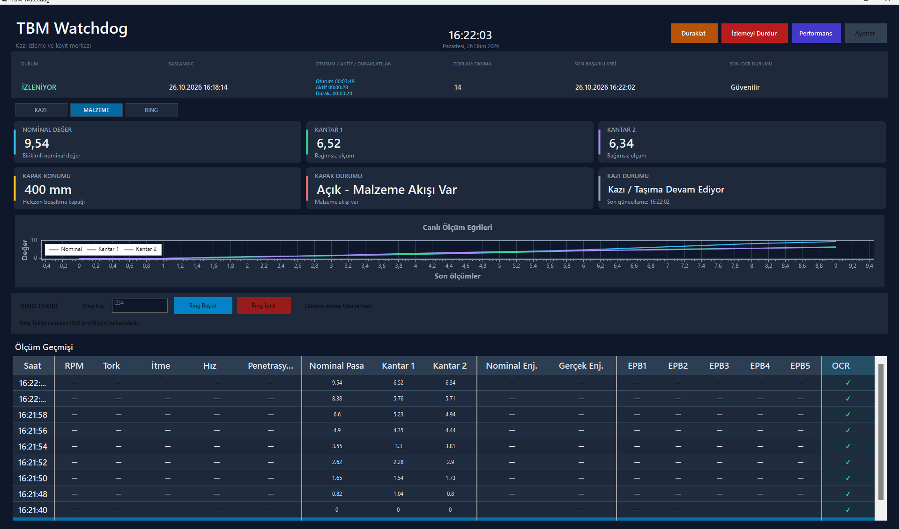
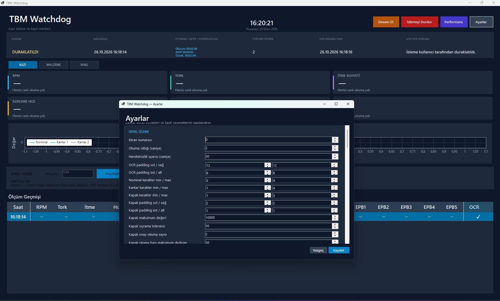
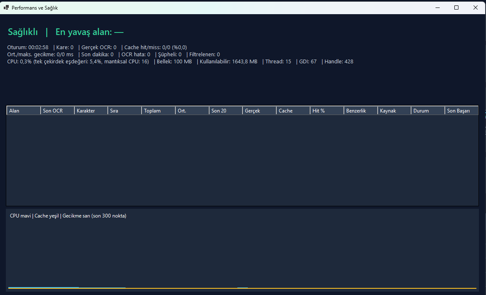

# TBMWatchdog

**Industrial TBM Monitoring & OCR-Based Data Acquisition**

TBMWatchdog is a Windows desktop application developed with **C# / .NET 8 and Windows Forms** for monitoring Tunnel Boring Machine (TBM) operating measurements. It combines configurable screen capture, Tesseract-based OCR, measurement processing and validation, dashboard visualizations, historical measurements, and CSV reporting.

> **Demo notice:** The screenshots below may show synthetic demo measurements. These are not readings from an operating TBM. The offline demo demonstrates the application interface and data processing pipeline, not the measured accuracy of real-world OCR.

## Features

- **Excavation monitoring:** RPM, torque, thrust force, penetration, advance speed, and advance distance.
- **Material monitoring:** Separate nominal, scale 1 and scale 2 values, gate position and material flow status.
- **OCR pipeline:** Configurable screen regions, Tesseract OCR and measurement reliability indicators.
- **Data visualization:** Live dashboard cards, charts and tabular measurement history.
- **Operational tooling:** CSV output, application logging, settings, monitoring sessions and health/performance panel.
- **Offline demo:** Synthetic data source for presenting the application without a live TBM screen.

## Screenshots

### Excavation monitoring — simulated data


### Material monitoring — simulated data



### Settings and screen-region configuration



### Performance and health monitoring



*In offline demo mode the performance screen may show zero real OCR operations.*

## Technology stack

- **Language / framework:** C#, .NET 8, Windows Forms
- **OCR:** Tesseract
- **Visualization:** ScottPlot
- **Additional libraries:** OpenTK
- **Data and diagnostics:** JSON, CSV, application logs
- **Version control:** Git, GitHub

## Build and run

**Requirements:** Windows 10/11 and the .NET 8 SDK with Windows desktop development support.

From the directory containing `TBMWatchdog.csproj`:

```powershell
dotnet restore .\TBMWatchdog.csproj
dotnet build .\TBMWatchdog.csproj
dotnet run --project .\TBMWatchdog.csproj
```

For real OCR operation, the required Tesseract language training data should be present under `tessdata` and an appropriate screen region must be configured. In offline demos the application can be presented without an active TBM display.

## Code organization

- `Controls/`: dashboard components and charts
- `Forms/`: main dashboard, settings and diagnostics windows
- `Models/`: measurement records and configuration definitions
- `Services/`: OCR, monitoring, simulation, storage and related services
- `Utilities/`: supporting parsing and domain utilities

## Project context

This project demonstrates desktop software engineering, OCR-based data collection, operational data workflows and developer-oriented diagnostics. Its **demo mode** is intended for portfolio demonstrations.

## Developer

**İclal Çengel** — Computer Engineer & Software Engineer  
[GitHub profile](https://github.com/iclalcengel)
